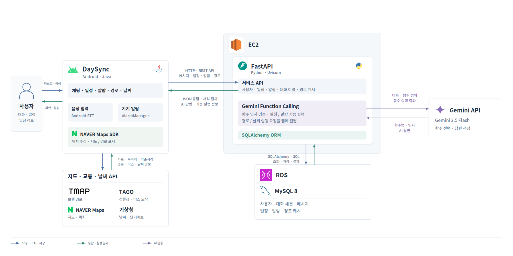

# 송재원 포트폴리오

> 백엔드 · AI 서비스 개발자

## 소개

서비스 흐름을 설계하고 신뢰성을 높이는 백엔드 · AI 서비스 개발자입니다. C언어부터 Spring Boot, FastAPI, Spring AI까지 다양한 기술을 활용하여 실제 문제를 기반으로 하는 프로젝트들을 완성했습니다.

데이터베이스 설계부터 API 연동과 구현, AWS 배포까지 백엔드 개발의 전체 과정을 경험했으며, 가전 고장 상담 서비스에서는 팀장으로 서비스 설계와 AI 상담 개발을 맡아 필요한 정보를 근거에 맞게 제공하는 구조를 고민했습니다.

**특징**
- 실제 문제 해결 중심의 프로젝트 경험
- 체계적인 사전 설계를 통한 안정적인 개발
- Spring AI · MCP 기반 AI 상담 서비스 설계 및 개발 경험
- 다양한 기술 스택을 활용한 풀스택 경험
- 팀장으로서 기획 총괄과 협업 경험

---

## 기술 스택

### Backend

### AI

### Database

### Frontend & Mobile

### Cloud & DevOps

---

## 학력 및 교육

**서원대학교 컴퓨터공학과**
- 2020.03 ~ 2026.02 졸업
- 주요 이수 과목: 자료구조, 알고리즘, 데이터베이스, 소프트웨어공학, 운영체제, 컴퓨터네트워크, Java, 모바일프로그래밍 등

**LG전자 AX School 1기**
- 2026.07 ~ 2026.12 (수료 예정)
- AI 애플리케이션 개발자 과정 (960시간): Python, DB, ML/DL, LLM API 및 팀 프로젝트

**클라우드 서버 엔지니어 양성 교육**
- 2025.10 ~ 12 이수 (충북인공지능산업협회)
- 서버·네트워크 구축 및 백업·복구, 클라우드 인프라 구성·운영 실습

---

## 프로젝트

### HomeCare AI - 가전 고장 증상 기반 AI 상담 웹 서비스
**2026.10.01 ~ 10.18 | LG전자 AX School 팀 프로젝트 (5명) | 팀장**

가전제품이 고장 났을 때 수리 전에 확인할 내용과 비용을 한곳에서 파악하기 어렵다는 문제에서 시작한 프로젝트입니다. 세탁기·건조기·냉장고·식기세척기의 증상과 오류코드를 입력하면 제조사 자료를 바탕으로 자가점검과 보증기간 및 참고 수리비를 안내하고, 공식 A/S 접수 경로를 제공합니다.

**Tech Stack**

**주요 기능**
- 팀장으로 기획을 총괄하고 기능명세·시퀀스·ERD 작성, 상담 흐름과 동작 규칙 결정
- Spring AI로 품목·모델 적용 조건을 먼저 거른 뒤 제조사 근거를 검색 (제조사 자료 1,542건 구조화)
- Spring AI(Java MCP 클라이언트)와 Python FastMCP로 읽기 전용 조회 도구 9개 연결, 요청별 JWT 전달
- 도구 선택은 AI가, 소유권·상태 검사와 보증·비용 판단은 Spring 도구 API가 맡도록 역할 분리
- 제품 소유권과 단계·상태 버전을 서버에서 검증해 오래된 카드와 중복 제출을 409로 거부

**개선 성과**
- **문서 임베딩 인덱스 재사용:** 자료·모델 설정의 SHA-256 지문 비교로 재시작 시 재임베딩 요청 25회 → 0회
- **근거 기반 답변 구성:** AI는 근거 ID만 선택하고 서버가 원문을 복원하도록 바꿔 동일 14문항 중 통과 4개 → 14개
- **자가점검 단계 제출:** 중간 단계를 React에서 처리해 5단계 제출 요청 5회 → 1회 (80% 감소)

**링크:** [GitHub](https://github.com/Sjoneon/AX_core_project) · [서비스 바로가기](https://homecare-omega-eight.vercel.app/)

---

### SOS Renewal - SSR 쇼핑몰을 React SPA + REST API로 전환
**2026.05 1차 마감 | 1인 개발**

기존 SOS 쇼핑몰의 Thymeleaf 화면과 서버 처리가 섞여 있던 구조를 React SPA와 Spring Boot REST API로 분리한 프로젝트입니다. 설계부터 구현, AWS 배포와 운영 점검까지 직접 진행했습니다.

**Tech Stack**

**주요 기능**
- React와 Spring Boot REST API로 검색·장바구니·주문 연결
- 키워드 선택 기반 추천을 대화형 AI 추천과 사용자/판매자 흐름으로 확장
- EC2·RDS 분리와 local/S3 이미지 저장 전략, CloudFront·WAF 적용 및 복구 기준 정리

**트러블 슈팅**
- **문제:** 기간상 Thymeleaf로 시작해 화면과 데이터 처리가 혼재했지만 기존 기능과 인증은 유지해야 함
- **해결:** 화면 상태는 React, 인증·검증은 서버로 나누고 기존 서비스와 세션 인증을 재사용해 로그인 흐름 유지. 공개 응답에서 재고 수량과 판매자 식별자를 제외하고 이를 직렬화 테스트로 검사
- **배운 점:** 기존 구조를 유지하면서 단계적으로 분리하는 전환 방식과 공개 응답 범위 관리의 중요성 체득

**링크:** [GitHub](https://github.com/Sjoneon/Style-of-Simplicity-renewal)

---

### DaySync - 하루를 시작할 때 필요한 정보를 한곳에서
**2025.03 ~ 11 | 캡스톤 프로젝트 | 1인 개발**

여러 앱에 흩어진 일정과 교통 및 날씨 정보를 한곳에 모아 하루의 준비를 돕는 Android 앱입니다. 이동 경로와 날씨를 확인하고 자연어로 일정과 알람을 등록할 수 있습니다.

**Tech Stack**

-3DDC84?style=flat-square&logo=android&logoColor=white)

**주요 기능**
- **Function Calling으로 일정·알람 등록:** 제목과 시간이 빠진 요청의 저장을 막고자 Function Calling 추출값을 FastAPI로 검증해 필수값을 갖춘 요청만 저장
- **지도·교통·날씨 API 통합:** 여러 앱을 오가던 불편을 줄이고자 지도와 교통 및 날씨 API를 Android 앱에 연동해 일정과 이동 정보를 한곳에서 확인
- **설계:** 클라이언트·서버 구조, 시스템 아키텍처와 기능별 시퀀스 정리
- **서버:** FastAPI REST API 구현, 외부 서비스 연동과 에러 핸들링
- **앱·배포:** Android(Java) 앱 구현, REST API 연동과 AWS EC2 서버 배포

**설계 산출물**

| 문서 | 링크 |
|------|------|
| 아키텍처 (4종) | [보기](https://github.com/Sjoneon/DaySync/tree/main/docs/architecture) |
| 시퀀스 다이어그램 (5종) | [보기](https://github.com/Sjoneon/DaySync/tree/main/docs/diagrams) |

**트러블 슈팅 · Retrofit으로 날씨 API 재시도 구현**
- **문제:** 날씨 API 오류가 지속되면 불필요한 요청과 사용자 대기가 늘어날 수 있어 재시도 횟수와 대기 시간을 제한해야 함
- **해결:** 기상청 API 호출 실패 시 2초 간격으로 최대 3회 재시도. 반복 실패는 오류로 안내하고 화면 종료 시 예약된 재시도를 취소
- **배운 점:** 외부 API는 정상 응답뿐 아니라 실패와 재시도도 고려해야 함을 체득

**남은 개선 과제**
- JWT 기반 인증 도입과 사용자별 데이터 관리 강화
- 현재 40~50초가 소요되는 버스 경로 탐색 최적화
- 환승 경로 지원으로 대중교통 이용 흐름 개선

**링크:** [GitHub](https://github.com/Sjoneon/DaySync)

---

### SOS (Style of Simplicity) - 키워드로 옷을 찾는 Spring Boot 쇼핑몰
**2024.03 ~ 06, 09 ~ 11 | 개인 프로젝트**

Spring Boot와 Thymeleaf 및 JPA로 체형과 상황 스타일 키워드에 맞는 상품 탐색과 주문 흐름을 구현했습니다. 패션에 익숙하지 않은 사용자가 상품을 고르고 장바구니와 주문 내역 조회까지 이어가도록 구성했습니다. 이후 SOS Renewal로 구조를 전환했습니다.

**Tech Stack**

**주요 기능**
- Controller(요청 수신 · Model 전달) → Service(회원·상품·주문 처리) → Repository(JPA CRUD · 조회 쿼리) 계층형 구조 설계
- Product-Keyword 다대다 관계로 체형·스타일·상황별 상품 매칭
- Cart와 Order로 장바구니와 주문 및 재고 차감 연결
- 세션 기반 로그인과 회원/판매자 권한별 접근 제어

**트러블 슈팅 · DB 연결 환경과 커넥션 풀**
- **문제:** DB 연결 오류로 상품·주문 흐름을 실행하기 어려워 의존성 버전과 커넥션 풀 설정을 점검해야 함
- **해결:** MySQL Connector와 pom.xml의 호환 버전 및 HikariCP 설정을 함께 점검해 DB 연결 구성을 보완
- **배운 점:** 이후 DaySync에서는 API 명세와 ERD 및 시퀀스를 먼저 작성해 요청·응답과 데이터 처리 위치를 정리하고, 화면과 서버의 책임을 나눈 뒤 구현하는 방식으로 개발 순서를 바꿈

---

### 렌터카 관리 시스템
**2024.03 ~ 05**

Java GUI 프로그래밍과 데이터베이스 연동 기술을 학습하기 위해 시작한 프로젝트입니다. MVC 패턴과 DAO 패턴을 적용한 데스크톱 통합 관리 시스템을 개발했습니다.

**Tech Stack**

**주요 기능**
- AbstractBaseDAO 클래스 도입으로 다중 DAO의 DB 연결 관리 문제 해결
- MVC 패턴 기반 아키텍처로 View-Business Logic 분리
- JCalendar 라이브러리 통합으로 직관적인 예약 날짜 선택 UI 구현
- 회원/차량/예약 통합 관리 기능 개발

**트러블 슈팅**
- **문제:** 회원DAO, 차량DAO, 예약DAO 등 각 DAO 클래스에서 중복된 DB 연결 코드로 인한 코드 중복과 연결 누수 위험
- **해결:** `AbstractBaseDAO` 추상 클래스 생성하여 모든 공통 연결 정보와 `getConnection()` 메서드를 상속으로 제공
- **배운 점:** 상속을 활용한 코드 재사용과 DRY(Don't Repeat Yourself) 원칙의 실용성 체득

---

### 대기줄 관리 시스템
**2023.09 ~ 11**

복학 후 처음으로 C언어만을 이용해서 실생활에서 불편했던 점을 목표로 삼고 개발한 첫 프로젝트입니다. 실제 업무 현장의 대기 시간 문제를 체계적으로 분석하여 사전 예약 시스템으로 해결했습니다.

**Tech Stack**

**주요 기능**
- 전화번호 기반 예약 등록/조회 시스템 구현
- 문의 등록 및 답변 시스템 개발
- 블랙리스트 관리 시스템 구축
- 파일 I/O 기반 데이터 관리 및 자동 정리 기능

**학습 성과**

체계적인 요구사항 분석과 모듈화된 개발 프로세스의 중요성을 체득한 첫 프로젝트입니다.

---

### 최적 경로 탐색 시스템
**2023.03 ~ 05 | 팀 프로젝트 (4명) | 개인 기여도 35%**

자료구조 수업에서 배운 그래프 알고리즘을 실제로 구현해보고자 시작한 팀 프로젝트입니다. Dijkstra 알고리즘을 C언어로 구현하여 여러 교통수단을 고려한 최단 경로를 탐색하는 프로그램을 개발했습니다.

**Tech Stack**

**주요 기능**
- TUI(Terminal User Interface) 전체 설계 및 단독 구현
- Dijkstra 알고리즘 핵심 로직 구현 보조 (30% 기여)
- 4가지 교통수단별 가중치 계산 로직 개발
- 검색 기록 저장/조회 기능 구현

**팀 협업**

4명 팀에서 팀장과 함께 주도적으로 개발을 진행했습니다. UI 전체를 단독으로 담당하고 알고리즘 핵심 로직 구현에도 기여했습니다.

---

## 연락처

- **Email:** spdjdps1649@gmail.com
- **GitHub:** [github.com/Sjoneon](https://github.com/Sjoneon)
- **Portfolio:** [sjoneon.github.io](https://sjoneon.github.io/)

---

## 포트폴리오 파일

이 저장소에는 다음 파일들이 포함되어 있습니다:

- `index.html` - A4 9페이지 분량의 인쇄용 포트폴리오 (HTML, 인쇄·PDF 저장 시 페이지 단위로 분리)
- `image/` - 프로젝트 화면 및 아키텍처 다이어그램
- `README.md` - 본 파일 (GitHub용 포트폴리오)

**포트폴리오 보는 방법**
1. https://sjoneon.github.io/     해당 링크 접속

---

## 핵심 강점

### 체계적인 사전 설계
- API 명세와 ERD 및 시퀀스를 먼저 작성해 요청·응답과 데이터 처리 위치를 정리한 뒤 구현
- DaySync에서 아키텍처 문서 4종과 시퀀스 다이어그램 5종 작성
- HomeCare AI에서 팀장으로 기능명세·시퀀스·ERD 작성

### AI 서비스 개발 경험
- Spring AI와 FastMCP로 AI 상담 도구 9개를 연결하고 서버 검증과 역할을 분리
- 제조사 자료 기반 근거 검색과 근거 ID 검증으로 답변의 원문 보존
- 평가 기준을 세우고 수치로 개선 결과 검증 (답변 구성 평가 4 → 14개 통과)

### 실제 문제 해결 경험
- 모든 프로젝트가 실생활 문제 해결에서 시작
- 대기줄 관리, 패션 추천, 일정 관리, 가전 고장 상담 등 실용적 솔루션 개발
- 사용자 경험을 고려한 기능 구현

### 다양한 기술 스택 경험
- C언어부터 Spring Boot, FastAPI, Spring AI까지 폭넓은 경험
- 데스크톱(Java Swing), 웹(Spring Boot, React), 모바일(Android) 개발 경험
- MySQL, Oracle 등 다양한 데이터베이스와 AWS(EC2·RDS·S3·CloudFront) 운영 경험

### 트러블 슈팅 능력
- 외부 날씨 API 오류 지속 → 재시도 횟수·간격 제한과 화면 종료 시 재시도 취소로 해결
- 반복 제출로 인한 요청 증가 → 화면 처리와 서버 검증 분리로 제출 5회 → 1회
- DB 연결 오류 → MySQL Connector·pom.xml 호환 버전과 HikariCP 설정 점검으로 해결
- DAO 코드 중복 → AbstractBaseDAO 상속 구조로 해결

### 협업 및 커뮤니케이션
- 5인 팀 프로젝트에서 팀장으로 기획 총괄과 코드 리뷰 수행
- 코드 리뷰와 문서화를 통한 효율적인 협업
- Git/GitHub를 활용한 버전 관리

---

**"단순한 기능 구현을 넘어, 사용자 경험과 코드 품질을 고려한 개발을 지향합니다"**

